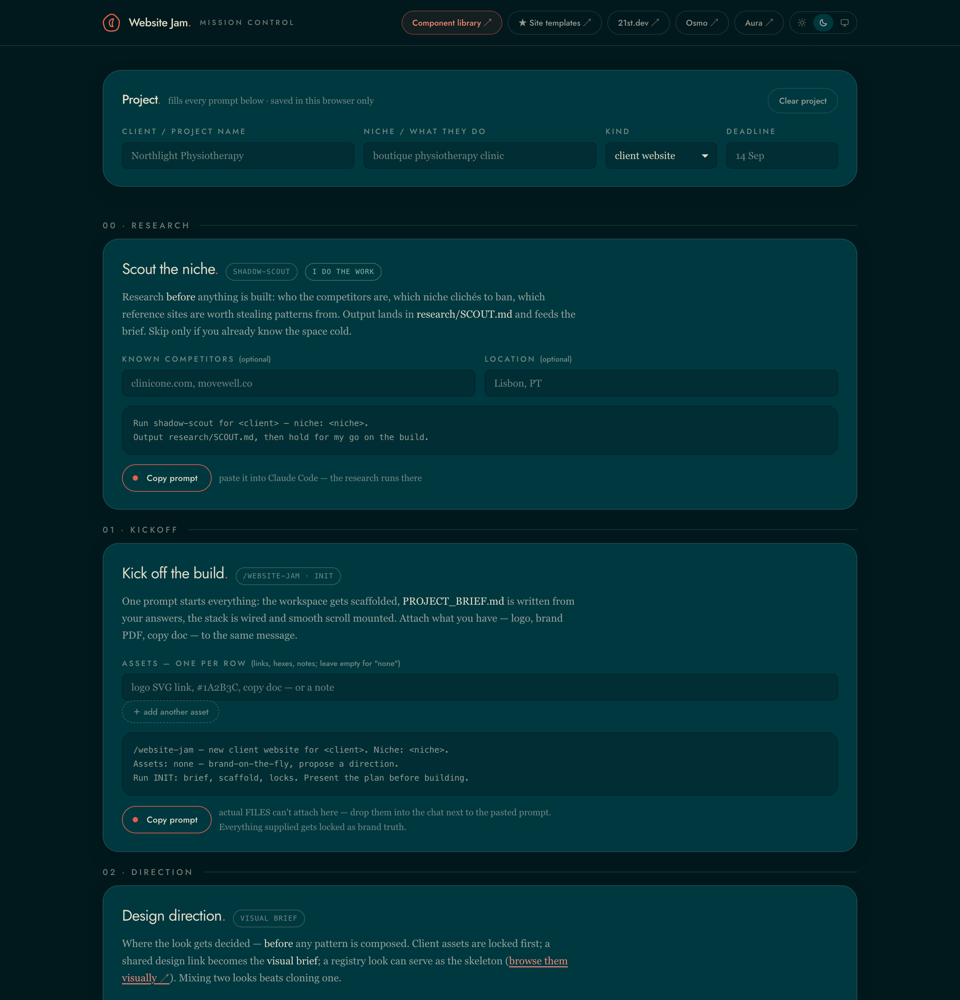
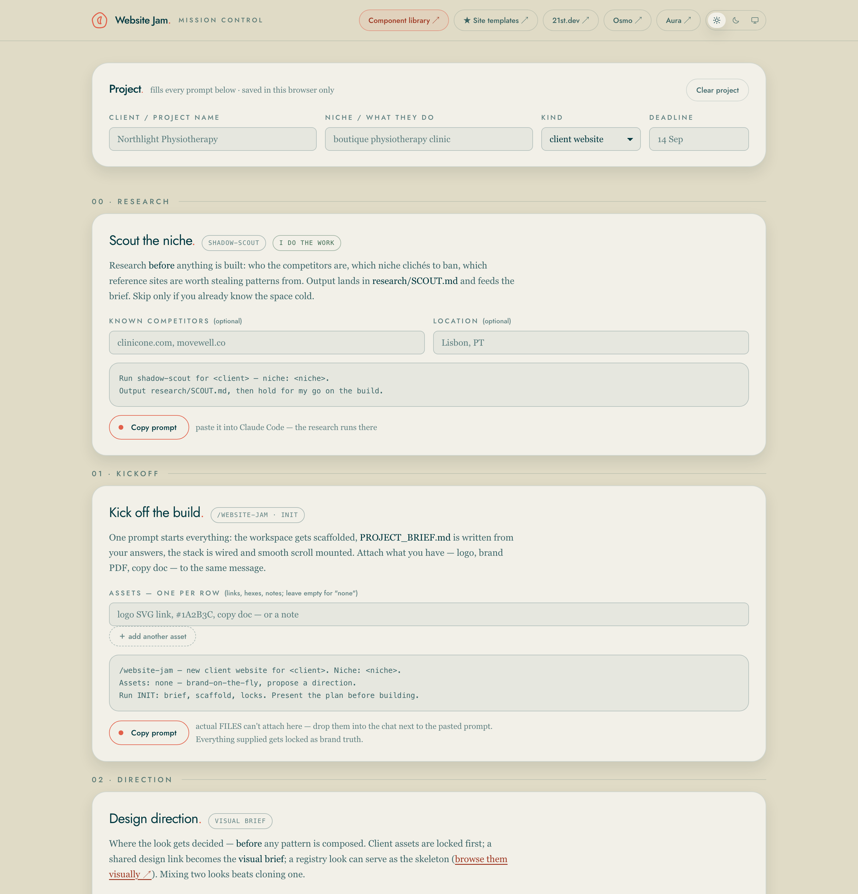

# website-jam

**One command for any website build. It figures out where you are.**

[](LICENSE)
[]()

A Claude Code skill for Next.js + Tailwind + Framer Motion landing pages and marketing sites. Invoke it once per session — `/website-jam` — and it reads your project's filesystem to work out whether you're starting cold, mid-build, ready for QA, or ready to hand off, then runs that flow. No sub-commands to memorize, no state to track by hand.

<p align="center">
  
  
</p>

## What it does

1. **Detects project state from the filesystem, not your memory.** No `PROJECT_BRIEF.md`? That's INIT. Brief exists but pages are stubs? That's compose. Pages changed but no QA folder for today? That's the QA gate. It checks `git diff`, file presence, and PR state, in order, and picks the first flow that matches.
2. **Composes pages from a fixed conversion skeleton**, not a blank page — hero, agitation, value stack, social proof, mechanism, objection handling, urgency, CTA. The Agora Black Book structure stays constant; the visual language (palette, type, motion) is whatever the brief locks in.
3. **Refuses to call anything "done" without a real-browser QA pass** — cross-browser Playwright, a Lighthouse budget, hover-state screenshots a headless run can't produce on its own, and a sweep for unsupported factual claims in the copy.

## How it routes

| You're here | website-jam sees | It runs |
|---|---|---|
| Nothing yet | No `PROJECT_BRIEF.md`, no `src/app/`, no `package.json` | **INIT** — asks project name, client-or-own, stack, reviewer, domain, deadline, brand direction. Scaffolds the workspace. |
| Brief written, no pages | `PROJECT_BRIEF.md` exists, `page.tsx` is still a stub | **BROWSE + ADD** — locks brand tokens, sets design direction, composes pages section by section from your pattern source of choice. |
| Pages built, unverified | Recent CSS/TSX edits, no `qa/<today>/` folder | **QA** — build check, Playwright across browsers, Lighthouse CI, real-browser hover/mobile screenshots, a claims ledger. |
| QA passed, PR stale | `qa/<today>/summary.md` shows PASS, no PR or an out-of-date one | **HANDOFF** — drafts/updates the PR with summary, test plan, and screenshot links. Never messages the reviewer for you. |
| Shipped | PR merged, site deployed | **POSTMORTEM** — time log, closeout notes, pattern-promotion check. |

A sixth flow, **SPEC MODE**, takes over when a project ships with its own `docs/` package (numbered spec files that are the brief, copy deck, and QA criteria all at once) — the specs override everything below them.

## The QA gate

This is the part that doesn't get to be optional. Before anything is called done:

- `npm run build` clean, Playwright across Chromium/WebKit/Firefox plus mobile viewports, Lighthouse CI at ≥90 on performance/accessibility/best-practices/SEO.
- A real-browser pass on top of the automated one — headless tests can't force `:hover`, so key interactive states get a manual screenshot pass, saved to `qa/<date>/manual/`.
- Any page touching WebGL/3D/shaders gets a separate GPU budget check (frame-time HUD, ≥55fps desktop / ≥30fps mobile floor) and a short screen recording — stills lie about shader motion, so the review has to watch it move.
- A copy claims ledger: every factual-sounding claim in the generated copy ("500+ projects," "10 years in business," a named result) gets checked against the brief or flagged `needs-source`. Nothing ships on an invented credential.
- The commit hash gets stamped into the QA summary. Any edit after that — even a "tiny" CSS tweak — invalidates the pass. QA describes one commit, not a vibe.

## Hard rules

Baked into every flow, not suggestions:

- Never auto-message a client or reviewer. You decide when and how a PR link goes out.
- Never deploy production for client work — the reviewer or client owns merge and deploy.
- Never skip the QA gate on a CSS or TSX change.
- Never hardcode brand assumptions — every visual choice traces back to a token pulled from the project's own brief.
- Never inline copy in JSX — it lives in `content.ts`, always.

## Mission Control

Six flows is easy to route automatically and easy to forget the details of by hand — what INIT needs to ask versus what HANDOFF needs to check. `mission-control/index.html` is a single-file, no-build control panel: open it in any browser, pick a flow, fill in the blanks, and it assembles the right prompt to paste into Claude Code.

No build, no server, no filesystem or session access — it's a static form that writes text for you to copy. It pulls one webfont and otherwise stays entirely offline. Keep it open in a tab while you work.

## Install

Via the plugin marketplace:

```
/plugin marketplace add TheShadowLeader/website-jam
/plugin install website-jam@website-jam
```

Or by hand — copy `skills/website-jam/` into your `~/.claude/skills/` directory.

## Working without a kit (and with one)

Nothing in website-jam requires a private component library. Left to itself it reaches for the project's own components first, then shadcn/ui, then 21st.dev — installing whichever it needs directly into the project, never handing you a command to run yourself.

If you keep a private pattern library (shared motion primitives, a token system, full-site templates), point `WEBSITE_JAM_KIT` at it and it becomes the first stop instead — an accelerator, never a dependency. Everything documented above works with or without one.

## Design

The reference implementation follows The Shadow Legacy's own system: midnight `#003840` · moonmist `#E0DBC6` · sunrise `#E2604A` as the sole accent · Jost (a Futura stand-in) for display, Georgia for body · pill controls, restrained radius, a full-stop as the signature mark. None of it is hardcoded into the skill — swap in your own tokens and the same flows apply.

## License

MIT © 2026 The Shadow Legacy

Built by [The Shadow Legacy](https://theshadowlegacy.com) — a boutique branding agency that ships its own tools.
